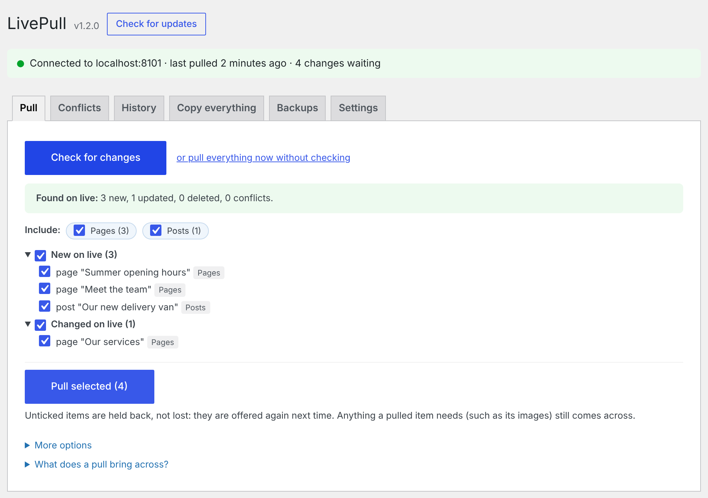

# WP Sync

**Pull your client's content changes from a live WordPress site into your local copy — without overwriting your own work.**

You're building or fixing something on a local or staging copy. Meanwhile the client keeps adding posts, pages, products and images on the live site. Normally you either work on stale content or copy the whole database down again and lose your changes. WP Sync gives you a third option: bring across just what changed on live, and leave anything you've changed locally alone.

- **Pull changes** – new and edited posts, pages, custom post types, media, categories/tags, custom fields, menus and key site settings.
- **Never overwrites your work** – if something changed on live *and* locally, it's left alone and flagged as a conflict for you to decide.
- **Copy everything from live** – a full database + uploads copy when you want to start fresh, with URLs rewritten safely.
- **Undo** – a backup is taken before every pull and copy; restore from the dashboard.
- **Works from WordPress or the terminal** – *Tools → WP Sync*, or `wp sync` (WP-CLI).
- **Read-only on live** – nothing is ever written to the live site.

> **Status: beta.** WP Sync is used in real projects and is well tested, but it's young. Keep backups (it makes its own before every change, too) and try it on a copy first. See [Limitations](#limitations).



---

## Requirements

- WordPress 5.8 or newer, PHP 7.4 or newer
- Installed on **both** sites: the live site (the one you pull *from*) and your local/staging copy (the one you pull *into*)
- The live site must be reachable from your local site over the internet (HTTPS recommended)
- Optional: [WP-CLI](https://wp-cli.org/) for the terminal commands

## Install

1. Download **`wp-sync.zip`** from the [latest release](https://github.com/alexmciver/WP-Sync-Tool/releases/latest). (Use this file, not GitHub's "Source code" zip.)
2. On **both** sites: *Plugins → Add New → Upload Plugin*, choose the zip, **Activate**.

Updates appear like any other plugin update (*Tools → WP Sync → Check for updates*, the Plugins screen, or *Dashboard → Updates*). Update both sites so they stay on the same version.

## Set up (2 minutes)

1. **On the live site:** *Tools → WP Sync* → **Generate key**, then **Copy** the **Connection code**.
2. **On your local site:** *Tools → WP Sync* → paste it into **Connection code** → **Save and connect**.

The screen now shows how many changes are waiting on live.

**Starting point matters.** WP Sync records changes on live from the moment it's installed there. The easiest setup is:
- Install on live first, then make your local copy (Local, WP Migrate, All-in-One, …) – or use **Copy everything from live** (below). WP Sync detects that the database is a fresh copy and pulls only what changes after that.
- Already had a local copy before installing? Do your first pull with **More options → Pull all content from live** (or catch up from the date you made the copy).

## Everyday use

On your local site, *Tools → WP Sync*:

| | |
|---|---|
| **Preview changes** | Shows what would be created, updated or deleted, and any conflicts. Changes nothing. |
| **Pull changes** | Backs up this site, then pulls. Progress is shown; large pulls run in batches and can be cancelled and resumed. |
| **Conflicts** | Items changed on both sides since the last pull. Choose **Use live version** or **Keep mine**. |
| **Your local changes** | Everything you've edited locally since it was last pulled. |
| **Undo a pull or copy** | Restore the backup taken before any pull or copy. |

## What gets pulled

| Every pull | Only with *Copy everything from live* | Never |
|---|---|---|
| Posts, pages, custom post types (incl. WooCommerce products) | Theme, Customizer and page-builder theme options | WooCommerce orders |
| Media library + files (all sizes) | Divi Theme Builder & Library, Elementor templates | Logged-in sessions |
| Categories, tags, custom taxonomies | Widgets, forms and other plugin settings | Theme and plugin files (keep those in Git) |
| Custom fields (ACF etc.) and page-builder content | Users | |
| Menus and menu locations | | |
| Site title, tagline, homepage, posts page, sticky posts, site icon, logo | | |

IDs that point at other content are re-pointed to the matching local items – featured images, galleries, ACF image/relationship/taxonomy fields, Gutenberg blocks, `[gallery]`, Divi galleries, WooCommerce galleries/upsells, Elementor data, menu items, homepage setting. Live URLs are rewritten to your local URL.

If a live item isn't linked to anything locally yet, WP Sync looks for the same thing (same post type + slug, same media file, same category slug) and links them instead of creating a duplicate.

## Copy everything from live

*Tools → WP Sync → Copy everything from live* replaces the local database with a copy of live and downloads missing or changed files from live's uploads folder.

- Off by default on live, because it shares the whole database: on live, *Tools → WP Sync → Let other sites pull from this one* → **Allow for 1 hour** (or **Always allow**).
- Your local database is fully backed up first; everything loads into temporary tables and is switched in at the very end, so **Cancel** leaves your site untouched.
- URLs and server paths are rewritten, including inside serialized and JSON data; a different table prefix is handled; a different WordPress version is reconciled automatically.
- Kept from your local site: its URL, its WP Sync connection, and "Discourage search engines".
- Afterwards, log in with your **live** username and password.

## Terminal (WP-CLI)

Run in your local site's folder.

```
wp sync status                     # connection + what's waiting
wp sync pull --dry-run             # preview
wp sync pull                       # pull (backs up first)
wp sync pull --since=2026-01-01    # catch up on everything changed since a date
wp sync conflicts                  # list conflicts
wp sync take <id> [--term]         # use live's version
wp sync keep <id> [--term]         # keep yours
wp sync local-changes              # what you've changed locally
wp sync clone                      # copy everything from live
wp sync backups                    # list backups
wp sync restore [<file>]           # undo
wp sync connect <connection-code>  # connect without the admin screen
wp sync key                        # (on live) show the connection code
```

## Security

- The key only allows **reading** from live. It's compared in constant time and must be 32+ characters. Treat the connection code like a password.
- Use `https://` for the live site; WP Sync warns if the key would travel over plain HTTP to a public host.
- *Copy everything* is opt-in and can be time-limited; logged-in sessions are never copied.
- Backups are kept outside the public web folder when the server allows (one folder per site), otherwise in `wp-content/wpsync-backups` with deny rules and unguessable file names.
- Files from live are only written inside uploads and never as executable or server-config files (`.php`, `.phar`, `.htaccess`, `.user.ini`…). Media is only downloaded from the live site or public addresses – never private, internal or cloud-metadata addresses.
- Updates are only installed from this GitHub repository over HTTPS.
- Deleting the plugin removes its settings, log, ID tags and backups.

Found a vulnerability? Please report it privately – see [SECURITY.md](SECURITY.md).

## Configuration

Everything works without configuration. Optional `wp-config.php` constants:

```php
define( 'WPSYNC_REMOTE', 'https://live.example' );          // instead of the connection screen
define( 'WPSYNC_SECRET', '…' );                              // same key on both sites, instead of the screen
define( 'WPSYNC_REMOTE_BASIC_AUTH', 'user:pass' );           // live/staging behind HTTP basic auth
define( 'WPSYNC_SSL_VERIFY', false );                        // staging with a self-signed certificate
define( 'WPSYNC_PAGE_SIZE', 20 );                            // smaller batches for huge page-builder pages
define( 'WPSYNC_PULL_MENUS', false );                        // don't pull menus
define( 'WPSYNC_PULL_OPTIONS', 'option_a,option_b' );        // pull extra options
define( 'WPSYNC_EXCLUDE_POST_TYPES', 'my_cpt' );             // never pull these post types
define( 'WPSYNC_EXCLUDE_TAXONOMIES', 'my_tax' );
define( 'WPSYNC_DEFAULT_AUTHOR', 'alex' );                   // fallback author on local
define( 'WPSYNC_BACKUP_DIR', '/absolute/path' );             // where backups go
define( 'WPSYNC_ALLOW_FULL_COPY', true );                    // (live) allow Copy everything permanently
define( 'WPSYNC_LOG_DAYS', 180 );                            // (live) days of change history to keep
define( 'WPSYNC_AUTO_UPDATE', true );                        // install updates automatically
define( 'WPSYNC_DISABLE_UPDATER', true );                    // never check GitHub for updates
```

## Extending

If a theme or plugin stores a post/image ID somewhere WP Sync doesn't know about, register it so it's re-pointed:

```php
add_filter( 'wpsync_meta_ref_keys', function ( $keys, $meta, $type ) {
	if ( 'post' === $type && isset( $meta['hero_image_id'] ) ) {
		$keys['hero_image_id'] = 'post';
	}
	return $keys;
}, 10, 3 );
```

Other filters: `wpsync_ignored_meta_patterns` (plugin cache fields that shouldn't count as edits), `wpsync_walk_content` (custom shortcodes), `wpsync_content_meta_keys` (builder data), `wpsync_block_id_attributes`, `wpsync_excluded_post_types`, `wpsync_excluded_taxonomies`, `wpsync_ignored_meta_keys`, `wpsync_pulled_options`, `wpsync_option_refs`, `wpsync_backup_tables`, `wpsync_full_copy_skip_tables`, `wpsync_full_copy_skip_dirs`. Actions: `wpsync_after_pull`, `wpsync_imported_post`, `wpsync_imported_term`.

## Tested with

Every release is checked by an end-to-end test suite that builds a real live site and a local site (with different IDs and table prefixes), pulls content across, edits it on live, pulls again and runs *Copy everything*. It currently covers:

| Area | Tested with |
|---|---|
| Editors / page builders | Gutenberg core blocks, Elementor, Beaver Builder, SiteOrigin Page Builder, Spectra, Kadence Blocks, GenerateBlocks, Divi 4 and Divi 5 content* |
| Shop | WooCommerce simple and variable products, galleries, upsells, attributes |
| Fields / SEO / languages | ACF (image, relationship, taxonomy fields), Yoast SEO, Polylang |
| Site structure | Menus, menu locations, homepage and posts page, site title, logo, icon |
| Safety | Conflicts (edited on both sides), deletions, undo, *Copy everything* |

\* Divi is a paid theme, so the suite checks Divi's saved content arrives intact and re-pointed but doesn't render it. Bricks, Oxygen, WPBakery and Brizy data is handled the same way but not yet covered by tests.

To run it yourself (needs PHP, MySQL/MariaDB and WP-CLI; put plugin zips in a folder):

```bash
WPSYNC_TEST_PLUGINS=~/plugin-zips DB_USER=root DB_PASS=secret tests/run.sh
tests/run.sh elementor woocommerce   # just some scenarios
```

## Limitations

- **One direction.** WP Sync pulls live → local. Pushing local changes up to live isn't supported (yet) – deploy those your usual way.
- Not supported yet: **multisite**, **WPML** (Polylang content works as normal posts/terms), **comments/reviews**, data in plugin-specific tables during normal pulls (e.g. Gravity Forms entries – use *Copy everything*).
- Conflicts are per item (a whole post or term), not per field.
- Must-use-plugin installs work but can't update themselves.

## FAQ / troubleshooting

**"Nothing to pull" but I changed something on live.** On live, *Tools → WP Sync → Let other sites pull from this one → Recent changes recorded on this site*. If your edit isn't listed, it's a kind of change normal pulls don't track (see the table above) – use *Copy everything*. If it is listed, check both sites run the same WP Sync version.

**"Invalid sync key".** Copy the connection code from live again.

**"The live site returned a web page instead of data".** A page cache or firewall on live is answering instead of WordPress. Exclude `/wp-json/` and URLs containing `rest_route=` from caching (host cache, cache plugin, Cloudflare rules). Quick check: open `https://your-live-site/wp-json/wpsync/v1/status` – you should see `"Invalid sync key."`, which means WP Sync is running and protected.

**"Another pull is already running".** If nothing is running (the tab was closed mid-pull), click **Unlock and pull again**. It also unlocks itself after 15 minutes.

**Duplicate pages after a pull.** Use *Undo a pull or copy* to restore the backup from before that pull, update to the latest version (it matches existing content), and pull again.

## Contributing

Bug reports and pull requests are welcome – see [CONTRIBUTING.md](CONTRIBUTING.md). Please include your WordPress, PHP and WP Sync versions, and what you expected vs what happened.

## Licence

GPL-2.0-or-later – see [LICENSE](LICENSE). Made by [Alex McIver / Alex M Web Design](https://alexmwebdesign.co.uk). WP Sync is provided as-is, without warranty; always keep backups.
